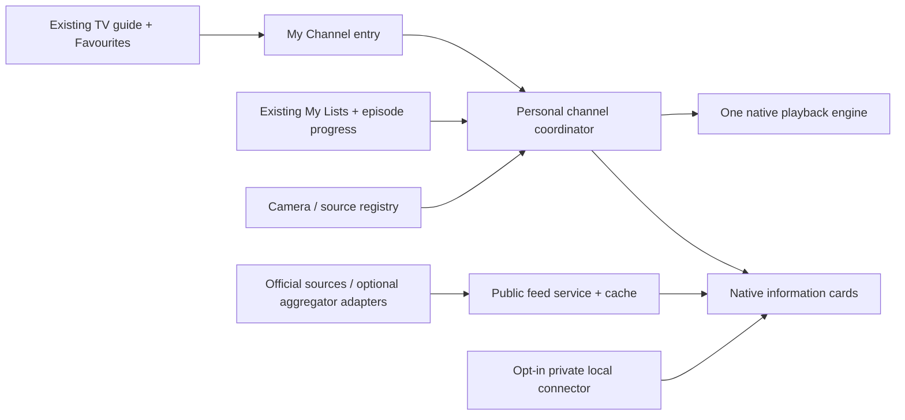

# Current implementation

See [Connected defaults](CONNECTED-DEFAULTS.md) for implemented video/data sources and validation. This supersedes prototype-only source statements below. Android integration remains outstanding.

## Updated default experience

Opening My Channel starts a ready-made mix immediately. No onboarding questionnaire or mandatory source selection.

- Start with Business & Markets; include World Window, Spain & Local and Space & Earth in a shuffled rotation every 15 minutes, without immediate repeats.
- Auto change is on by default, optional to disable. Skip and Stay on this remain directly available.
- Finish films, talks and episodes before changing. Use the next unwatched episode when a saved programme queue is selected.
- Default watchlist: GBP/EUR, GBP/USD and FTSE 100. Distinguish daily reference rates from live prices.
- Default news topics: business, economics and world news. Use a maintained editorial source list, not a mandatory source picker.
- Spain defaults to national content; town-specific weather stays hidden until a location is supplied. Never infer a home address.
- Production selects healthy playable sources automatically and skips unavailable integrations. Missing API keys are an implementation concern, not a viewer setup task.
- All personalisation is optional under Customise your mix. Remember later choices; never reset them on each launch.

This supersedes earlier off-by-default and mandatory selection wording below. Prototype video remains illustrative and unconnected.

# UK Television — My Channel

Product design · 25 October 2026 · Version 1.0

**One channel inside the existing UK Television guide.** It combines one playable picture with optional live information and a user-controlled rotation or programme queue. It is not a separate app, dashboard or replacement home screen.

This package designs the product. It does not install a Firestick build, deploy a data service, subscribe to providers or establish camera/video availability. The clickable prototype uses illustrations and an explicitly dated ECB reference-rate snapshot; other feeds remain unconnected.

## 1. The viewing experience

Find **My Channel** in **Main UK**, after the existing priority UK broadcasters. It can be added to existing Favourites. Opening it uses the current app's playback surface and remote conventions. Back always leads out; no navigation dead ends.

On first use, select a preset. Subsequent visits restore the chosen preset, layout, data panels and content. Live sources return to their live edge. Programme queues resume the exact episode and stored position. If the old source is unavailable, keep the channel open and offer another route or a clear choice; never fall back silently to an unrelated channel.

There are two picture layouts:

- **Picture only:** unobstructed video, aspect ratio preserved, controls shown on demand. Default for films, episodes and talks.
- **Picture + information:** one video occupying roughly 70% of the screen, with up to three native information cards in the remaining space. Default for the business/local/world presets. Side panels are optional and remembered per preset.

The proposed TV layout uses 48 dp safe margins, visible focus, minimum 48 dp remote targets and at least 18 sp secondary text at the Android TV layout scale. The browser prototype scales for laptop review; its CSS pixel sizes are not the native TV typography specification. No important text is overlaid on a broadcaster's lower-third graphics. Programme controls and an optional headline strip hide after inactivity; a fixed full-time ticker is off by default.

No multi-video wall on the current Firestick. Camera selection uses snapshots, and selecting a camera replaces the one active video.

## 2. Presets within this one channel

| Preset | Picture | Optional information | Default transition |
|---|---|---|---|
| Business & Markets | One of the app's existing business broadcasters | Currency references, explicitly live/delayed quotes, selected business headlines and release calendar | Stay with chosen broadcaster |
| World Window | A pinned city, coast, harbour, landscape or wildlife camera | Location, local time, image-capture time, local weather and chosen regional headlines | Stay, or user-enabled camera rotation |
| Spain & Local | Existing Spanish TV or a chosen local camera | AEMET forecast/warnings, regional headlines and events | Stay, or user-enabled rotation |
| Space & Earth | Verified ISS view, mission broadcast or selected documentary | Mission schedule and dated space-weather observations | Stay; distinguish blackout, replay and offline |
| British Classics | Exact episodes from the existing UK comedy/classic-show lists | Programme description, series/episode, progress and next title | Finish episode; next only if autoplay enabled |
| Practical Living | Saved renovation, homesteading and practical programmes | Programme details, optional local conditions; optional actual property telemetry | Finish episode |
| Technology & AI | Selected supported talks, explainers and events | Official release notes, dated research and user-selected topics | Finish talk |

Presets change the configuration of My Channel, not the number of guide channels. The title in the guide stays **My Channel**. A subtitle identifies the current preset. Keep topic and source choices editable rather than infer a permanent profile from past conversations.

The mockup's Gaucín, private land, Starlink and sensor references are not established facts. Request an explicit location and device connection before showing such data. No private work, client information or household telemetry appears by default.

## 3. Optional Auto change

**Off initially.** MENU → Auto change offers an included pool, order and switching rule.

- Pool: selected presets; a pinned camera collection; selected live broadcasters; or an existing My Lists queue. Select at least two playable choices for rotation. Keep these different scopes explicit.
- Order: shuffle without immediate repetition, or the user's order. Shuffle uses a bag to visit eligible entries before restarting; new/unavailable entries are handled without replaying the current item.
- Timed camera/live rotation: 5, 15 or 30 minutes, with a custom duration in setup. A live broadcast may be changed mid-programme only because the user explicitly enabled timed live rotation; show that consequence beside the setting.
- VOD: switch on episode/talk completion by default, not on a clock. Never randomly select an episode ahead of the viewer's progress. A series queue uses the next unwatched episode; shuffling series chooses between series, then preserves each series' episode order.
- A mixed pool waits for VOD completion, and uses the timer on live/camera entries. Unknown duration waits for an explicit end event or manual Skip; lack of a duration must not cause a timed cut.
- **Skip** advances once. **Stay on this** turns automatic changes off without losing the configured pool. Pause, source selection and settings suspend the timer. Leaving the channel suspends it; no media is advanced in the background.
- Brief optional “Next: …” notice before a timed change; the remote can cancel it. No takeover alerts force a switch.
- Offline/blocked entries get a cooldown and an explanation. If the pool has only one available entry, stay there. If none is available, retain the shell and show choices. Avoid endless startup loops.

The prototype's optional ten-second demo changes illustrations three times, then stops. Production intervals are minutes or programme boundaries. The demo is not live camera playback.

## 4. Remote behaviour and navigation

| Remote input | While watching My Channel |
|---|---|
| OK | Show controls; OK again activates the focused control. Does not unexpectedly change preset. |
| MENU | Open My Channel menu: setup/preset, picture/source, Auto change, information, queue and sources. Long hold is safely debounced. |
| Back | Close the current sheet first. Otherwise return to the existing guide with My Channel focused. Never exit the entire app from the first Back. |
| Left/right/up/down | Move the visible focus. While controls are hidden, show them first. No hidden accidental preset changing. |
| Play/pause | Pause/resume VOD. For live sources without timeshift, explain that resuming returns to live; do not imply DVR. |
| Channel up/down | Follow existing app behaviour and leave My Channel for the adjacent guide station. Stop its collectors/player observers. |
| Hold OK | Preserve the app's current source-picker convention; no separate gesture vocabulary. |

Browser review keys are arrows/Enter, M for MENU and Escape for Back. The review controls below the television are not part of the Android app.

On entering My Channel from Favourites, retain that guide context. Returning from a drawer restores focus to the control that opened it. Empty lists, unavailable video and offline feeds must always leave MENU and Back reachable.

## 5. Data integrations and provenance

Use a small public-data aggregation service plus independent direct-media playback. The service fetches, bounds, validates, deduplicates and caches information. The Firestick reads compact snapshots and never runs an entire intelligence dashboard. The Mac is not a required server.

| Integration | Proposed use | Access/dependency | State at design delivery |
|---|---|---|---|
| ECB | GBP/EUR/USD reference observations | Public official data; daily reference, not a trading quote | One real snapshot captured, dated 23 Oct 2026; not a live connector |
| AEMET | Spanish forecasts and warnings | Explicit area + API key | Documented candidate; not connected |
| Market-data provider | User watchlist and quote feed | Instrument coverage, latency, display terms and budget must be selected | Not selected; no price or plan assumed |
| Publisher RSS / official releases | Business, UK, Spain and technology headlines | Source-specific availability and reuse terms | Curated allowlist to be agreed; no fabricated headline fixtures |
| Crucix | Optional reusable collectors for selected source domains | Its published code is AGPL-3.0; upstream services still have their own requirements | Repository reviewed at documentation level; no code adopted or service deployed |
| World Monitor | Optional structured regional/event data | Hosted access is authenticated and subject to subscription/quota terms | Optional adapter; no account or paid access assumed |
| Windy webcams | Camera discovery, current images and timelapse metadata | API key and attribution; image URLs expire | Documented candidate; continuous live video must be verified separately |
| NASA / NOAA | Candidate mission video and space-weather data | Each video route and data product separately verified | Proposed connectors; no playable-stream guarantee |
| Home Assistant / compatible private cameras | User's own device readings or cameras | Explicit local connection and supported protocol | Off; not assumed to exist |

Start with direct official connectors where reliable. Crucix and World Monitor are optional accelerators, not mandatory dependencies for every screen. Do not copy their full dashboards, inferred risk scores or automatic trade suggestions. Any copied code needs a pinned revision, dependency/security review and a recorded licence decision; integrating source code and using a hosted API are different choices.

Treat feed observations, publisher claims and generated summaries differently. The underlying source and its time remain accessible through OK → source detail. A summary cannot replace the original reading or imply confirmation from several sources when they are reposting the same report.

### Update policy (design targets, constrained by provider terms)

- Selected public snapshot: fetch on channel entry and then 60–120 seconds while visible, using ETags/conditional requests. Feed observations may be older; do not relabel them with the poll time.
- News: collect about every 5 minutes where permitted; deduplicate by canonical item and date; retain a bounded 24–48 hour window.
- Weather: observations/forecasts on a 10–15 minute schedule; official alerts on a separately permitted shorter interval. Forecast validity is not an observation timestamp.
- ECB: daily/reference cadence, aware of publication calendar. No per-second refresh or animated price changes.
- Market quotes: provider-approved streaming or polling only; explicit real-time/delayed/reference label. Quota exhaustion does not fall back to invented numbers.
- Camera metadata: periodic maintenance. Re-resolve tokenised image URLs on opening/expiry; do not persist temporary image URLs as camera identities.
- Private devices: local adapter with user-chosen frequency; no upload into the public catalogue.
- Inactive screens: no polling per hidden card. Stop observers when leaving My Channel. On connectivity loss, exponential backoff with jitter and an upper bound.

A feed record contains `observedAt`, `publishedAt` where applicable, `fetchedAt`, `validUntil` where known, cadence, source identity and status. A successful network response is not evidence of a fresh observation. Display “Reference · 23 Oct”, “Delayed 15 min”, “Captured 14:08” or “Last updated …” as appropriate. Unknown data is “Unavailable”, never zero.

## 6. Cameras and media-source maintenance

Keep a registry with stable camera ID, location, timezone, source publisher, attribution, supported playback method, type and route-resolution strategy. `live_video`, `periodic_image`, `timelapse` and `replay` are distinct types. Do not turn still-image sequences into a fake live badge.

Public native HLS/DASH routes are preferred when permitted and supported. An embed-only camera is evaluated separately for remote accessibility, memory and the user's in-app requirement. If it cannot work inside the app, it is unavailable for automatic rotation rather than an external-app launch. No silent DRM/login bypass or assumption that a public webpage grants redistribution rights.

Check URL resolution, manifest validity, audio/video track availability and first decoded video. A periodic image needs an image and capture timestamp; an HTTP 200 alone is insufficient. Health is regional: backend success does not prove playback through the Firestick's VPN.

Alternative routes must identify the same camera/feed or exact episode. A different camera or broadcaster is a user-approved rotation choice, not a failover pretending to be the same content. Maintain all useful alternatives; failures adjust health and cooldown, not permanently erase them.

Auto health checks should be spread out and bounded. Probing every route simultaneously from a 1 GB Firestick is forbidden. The client checks the selected source; the service maintains a small validation queue. A manifest can be refreshed on demand without downloading whole programmes.

## 7. Programme queues and the existing On Demand system

Reuse saved title IDs, user lists, favourites, provider selection and episode progress. No second parallel library. Curated British lists remain under My Lists.

A queue item is an exact playable episode/film/talk or a series continuation request. Resolve it shortly before playback, retaining selected/excluded providers. Preflight metadata and route only; do not start a second decoder to “warm up” the next item.

On error, retain position and attempt a compatible route for the same episode. Prefer availability/verified playback, then acceptable quality. CAM/unknown-quality sources must be labelled and excluded when the user's quality rule demands it. Next episode/skip is explicit unless the user has enabled an agreed skip rule. Subtitles, language and age preferences survive failover.

Never treat a title in a catalogue as a verified playable source. Crew browsing and its app transitions are not silently reintroduced as a supposedly seamless backend. Every provider must meet the in-app playback contract before it joins an unattended queue.

## 8. Architecture inside the current app

Add a distinct local guide-entry type for My Channel; do not invent a fake HTTP stream URL to satisfy the current station parser. It has a stable identity and normal favourite support. Extend existing navigation to open its coordinator, and keep real channel/stream/EPG identities intact. Do not bulk rewrite all stations or fetch another full guide.

The coordinator owns the current preset, source, layout, optional rotation, queue cursor and playback lifecycle. Feed refresh and video playback are separate jobs. Recomposition of a data card must not recreate the player or its surface.

Maintain at most one active video decoder. Release the previous decoder before switching; a held poster can conceal the transition. No hidden provider WebViews behind native playback after successful handover. Keep the existing memory fix and source-recovery paths. Audio success is measured by output, not merely a declared track.

Keep public data off-device in bounded caches; keep personal configuration/progress locally. Proposed API surfaces are `GET /v1/feed-snapshot`, `GET /v1/cameras`, `GET /v1/cameras/{id}` and authenticated route resolution where required. Provider secrets stay server-side. See `data-contracts.json` for example contracts; they are design examples, not active endpoints.

No dependency on an always-awake Mac. Public aggregation needs an existing suitable host or a separately chosen deployment destination. This design does not authorise a new paid host. Private camera connectivity can be local and separate from the public service.

## 9. Reliability, security and privacy

- One decoder, bounded native buffers, small information snapshots and bounded image caches. Start with 720p on the current low-memory Firestick; measure before offering higher default quality.
- Target cached controls within 100 ms, cached channel shell within 1 second and no sustained UI-thread blocking. These are acceptance targets, not measured promises.
- Separate status for picture, each information source and the network. A headline failure must not stop the picture. A camera failure must not erase weather or disable Back.
- Cap response sizes, parse incrementally, limit concurrency and reject malformed times/coordinates/URLs. Never load unlimited histories or full dashboards on the TV.
- Public connections use HTTPS and validated public destinations, including redirects. Reuse and extend the existing public-stream protections. Private LAN devices require a separate explicit allowlist and trust boundary; do not weaken the public SSRF policy to make local cameras work.
- Store private tokens with Android-backed encryption; never in public Git data or APK constants. No private camera endpoints in public catalogue publishing, screenshots or logs.
- Read-only connections by default. Home/door/energy controls are outside this product. No automatic trading or account actions.
- Feed and camera attribution remain visible. Before using commercial/API services, verify display/reuse rules and quota, not just technical reachability.
- AI summaries, if later enabled, remain clearly identified, source-linked and optional. No model is required to watch the channel or refresh basic data.
- Diagnostics are bounded and redact query tokens, headers, private addresses and viewing detail. User support export is deliberate.

## 10. Failure states the product must show

| Failure | Viewer-facing response |
|---|---|
| Data connection lost | Keep video; show dated cached data and retry status. |
| Feed stale | Keep observation time; mark stale based on that feed's cadence. |
| API not configured | “Connect source” or hide the card. No sample numbers in production. |
| Camera offline | Show last image with capture time; offer retry or an allowed next camera. |
| Token expired | Re-resolve once; bounded retry; retain stable camera identity. |
| Region restriction confirmed | Explain the provider's supported region; offer an in-app alternative. Never promise a VPN defeats restrictions. |
| HTTP 403 with no confirmed reason | “Access refused”; do not falsely label it geoblocking. |
| VOD source unavailable | Preserve episode and progress; try an allowed equivalent or offer choices. |
| Renderer/memory failure | Release resources, preserve state, offer lower quality/retry; no silent bounce to the library. |
| No guide data | Honest channel/queue description; no fabricated time slots. |
| No usable rotation entries | Stop rotation, retain controls and explain. |

## 11. Delivery sequence and acceptance

1. **Native channel shell:** local virtual entry, Favourites integration, remote navigation, remembered presets/layout; no data service dependency. Verify Back and focus from guide/Favourites, offline and empty states.
2. **Public information:** direct ECB/AEMET/curated feeds with provenance and cache. Add API keys only through a defined secure setup. Verify stale, rate-limited, malformed and unavailable feeds; no video restart on refresh.
3. **Camera registry and Auto change:** verified limited camera set, typed still/timelapse/live labels, shuffle bag, timers, hold/skip and failover. Test repeat avoidance, paused/background timers, one available source and all unavailable sources.
4. **Personal queues:** reuse My Lists, exact episode progress, provider exclusions and source recovery. Test no mid-episode rotation, same-episode fallback and return to controls.
5. **Optional aggregators and private devices:** only after the baseline works on the real Firestick and source access/licensing is established.

Release gate on the user's actual Firestick: repeated entry/exit and 60-minute mixed viewing soak, bounded memory after 50 camera/source transitions, audio/video output verified, no ANR, and no hidden decoder after leaving the channel. Exercise VPN/network loss without altering the user's VPN settings. An emulator pass alone is insufficient. Any test or install that interrupts viewing must respect the user's current permission.

The final product is complete when it is useful with a small set of working sources, has honest disconnected states, supports user-controlled automatic changes, and stays inside the existing UK Television app. It does not require every possible integration to be present on day one.

## 12. Sources checked for the design

- [Crucix repository](https://github.com/calesthio/Crucix): collector architecture, documented refresh behaviour and published licence.
- [World Monitor developer documentation](https://github.com/koala73/worldmonitor/blob/main/public/developers.md): authenticated API access and access limitations.
- [Windy webcam documentation](https://api.windy.com/webcams/docs): API key, image/timelapse metadata and expiring URLs.
- [World Monitor webcam implementation notes](https://github.com/koala73/worldmonitor/blob/main/docs/webcam-layer.mdx): distinction between images, timelapse and live-video candidates.
- [AEMET OpenData](https://opendata.aemet.es/centrodedescargas/info): official API access and key requirement.
- [ECB data API](https://data.ecb.europa.eu/help/api/data) and [daily reference file](https://www.ecb.europa.eu/stats/eurofxref/eurofxref-daily.xml): official reference observations. The HTML API help returned a temporary error during this design; the XML snapshot retrieval succeeded.
- [NASA viewing options](https://www.nasa.gov/ways-to-watch/) and [NOAA data directory](https://services.swpc.noaa.gov/json/): candidate video/data sources, subject to individual integration verification.
- [Home Assistant camera integration](https://www.home-assistant.io/integrations/camera/): optional private-camera integration; no device connection has been made.
